# Métriques d'affinité

Quelles parties d'une puce vont ensemble ?

---

## D'une puce à un graphe
- Une puce contient des cellules, les petites briques du circuit
- Les cellules communiquent entre elles par des fils
- On dessine chaque cellule comme un point, appelé nœud
- Un trait entre deux points est une arête : les deux cellules sont reliées
- Le nombre sur une arête est son poids : combien de fils relient la paire
- Ainsi, A–B a un poids de cinq : cinq fils relient A et B
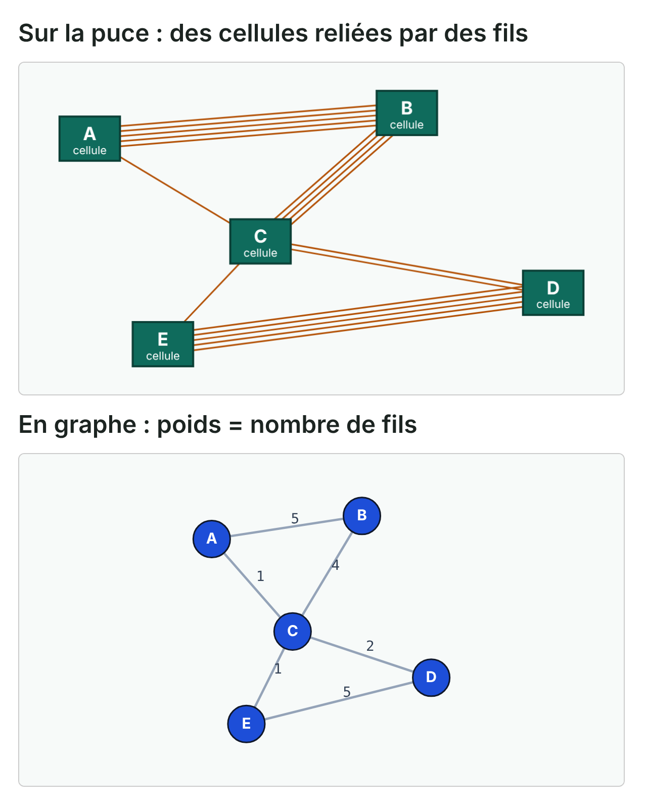

---

## Pourquoi regrouper les cellules ?
- Les cellules qui échangent beaucoup de signaux doivent être proches
- Des fils courts rendent la puce plus rapide et économisent de l'énergie
- Regrouper les cellules proches s'appelle le clustering, et chaque groupe est un cluster
- Pensez à un plan de classe : les amis qui discutent beaucoup s'assoient ensemble
- Ici, A, B et C forment un groupe, et D et E en forment un autre
- Seules les arêtes rouges passent d'un groupe à l'autre, et on en veut le moins possible
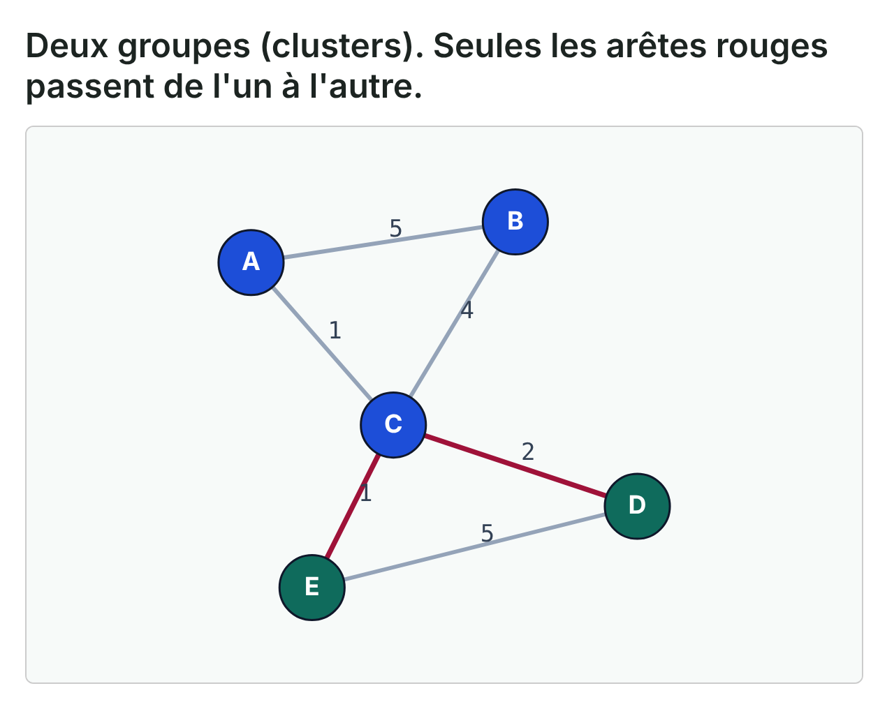

---

## Qu'est-ce que l'affinité ?
- L'affinité est un score donné à chaque paire de cellules
- Un score élevé veut dire que ces deux-là doivent être dans le même groupe
- Un score faible veut dire qu'elles peuvent être séparées
- Les algorithmes de clustering fusionnent d'abord la paire qui a le meilleur score
- La recette du score décide donc de tout ce qui suit
- Ce lab compare trois recettes sur le même petit exemple

---

## Un petit graphe pondéré
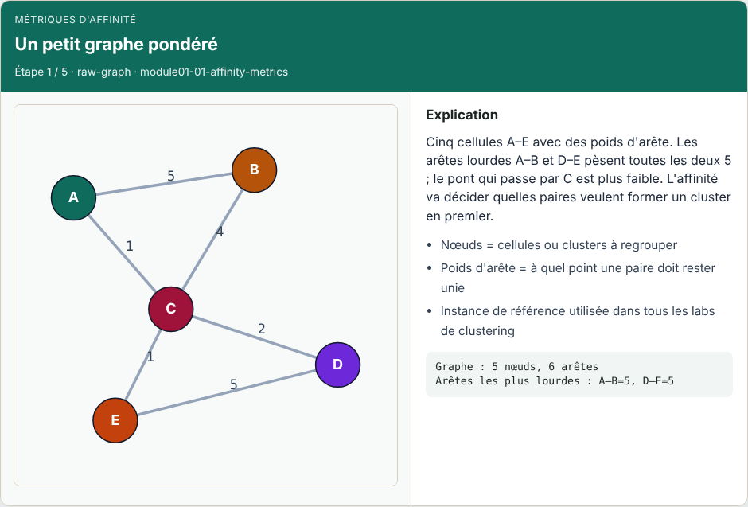

---

## L'affinité par poids d'arête classe les paires
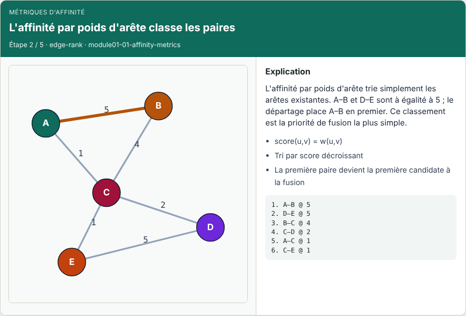

---

## Les voisins communs renforcent A–B
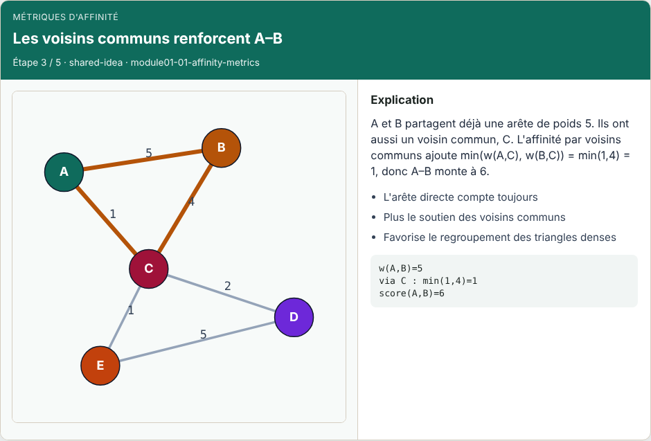

---

## Le classement par voisins communs rebat les cartes
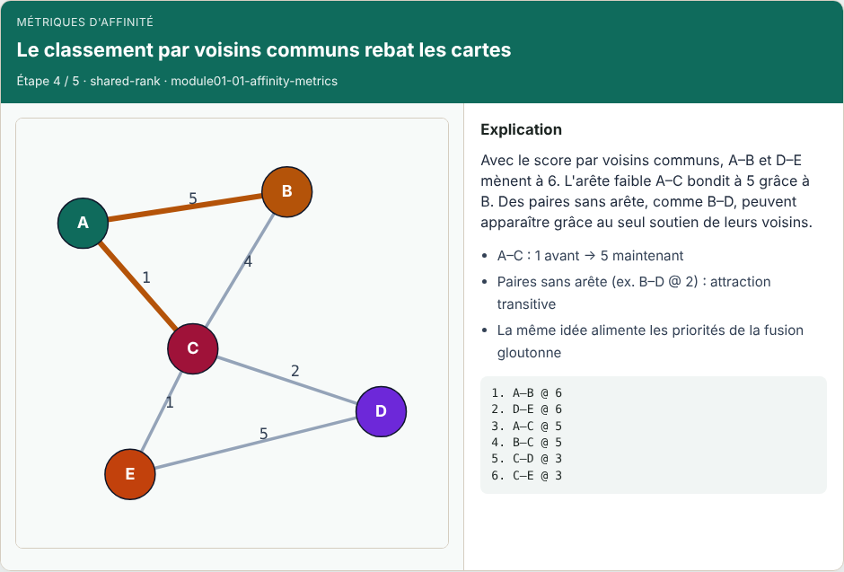

---

## Pourquoi l'affinité compte en EDA
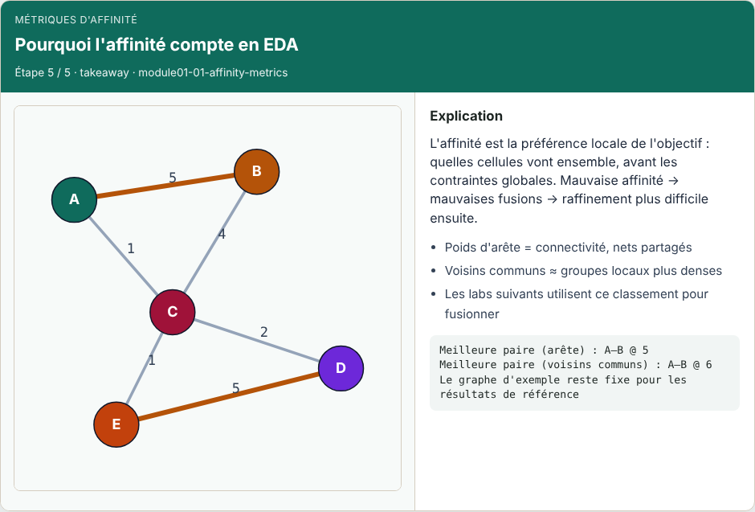

---

## Exemple résolu : le score de A–C
- Calculons un score ensemble, étape par étape
- Étape un : l'arête directe A–C a un poids de un
- Étape deux : A et C ont un voisin en commun, B
- Les liens qui passent par B pèsent cinq et quatre, on garde le plus petit : quatre
- Étape trois : on additionne, un plus quatre font cinq
- Seule, A–C était faible, mais elle devient forte grâce à son ami commun
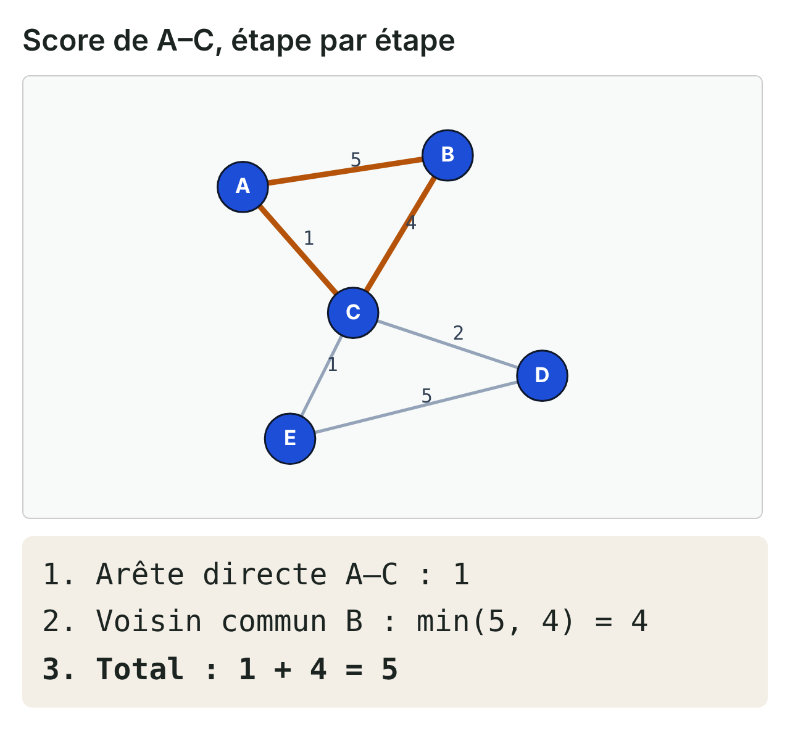

---

## Dix paires, pas six
- Avec la deuxième recette, notre petit graphe donne dix paires au lieu de six
- Quatre d'entre elles n'ont aucun fil entre elles
- Par exemple, B et D ne sont pas reliés, mais tous les deux sont reliés à C
- B–D obtient donc le plus faible de ces deux liens : deux
- C'est comme deux personnes qui ne se sont jamais vues mais ont le même meilleur ami
- Seules les paires dont le score vaudrait zéro sont exclues

---

## La deuxième recette en pseudo-code
- Voici la deuxième recette écrite sous forme d'étapes qu'un ordinateur peut suivre
- D'abord, chaque arête ajoute son poids à sa propre paire
- Ensuite, pour chaque paire de nœuds, on regarde chaque voisin qu'ils ont en commun
- Pour chaque voisin commun, on ajoute le plus petit de ses deux liens
- On garde chaque paire dont le score finit au-dessus de zéro
- Enfin, on trie par score décroissant et on départage les égalités par ordre alphabétique

---

## La deuxième recette en pseudo-code — try these

```
affinity_shared_neighbors(nodes, edges):
  score[u,v] = w(u,v) pour chaque arête
  pour chaque paire (u, v) de nœuds :
    s = 0
    pour x dans voisins(u), x != v :
      si x dans voisins(v) :
        s += min(w(u,x), w(v,x))
    si s > 0 ou (u,v) a une arête :
      score[u,v] += s
  trier par score (décroissant), puis u, puis v
```

---

## Même graphe, première fusion différente
- Voici un deuxième exemple qui montre pourquoi la recette compte
- Prenons un triangle serré P, Q, R, dont chaque arête pèse quatre
- À côté, une paire isolée X–Y a un poids de cinq
- La première recette choisit X–Y, car cinq bat quatre
- La deuxième donne à P–Q quatre, plus quatre via R : huit
- P–Q passe donc en premier
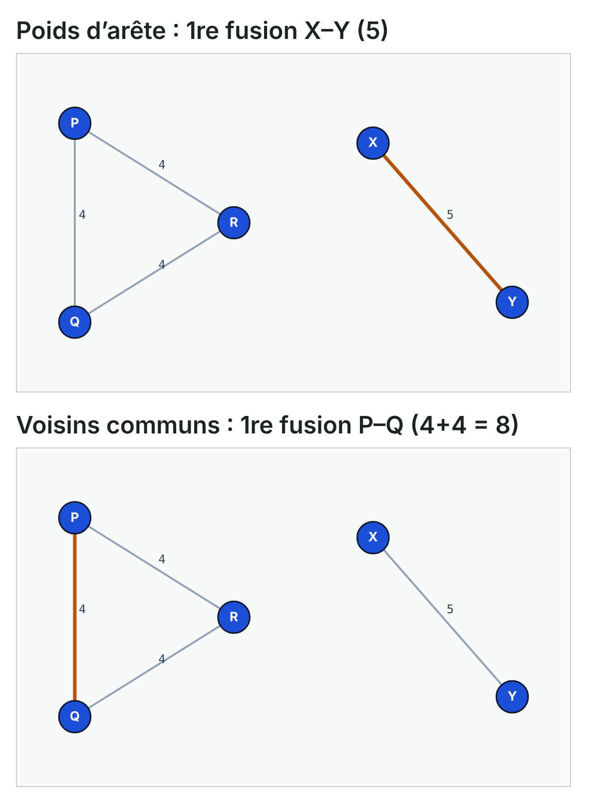

---

## Des nets à nombreuses broches
- Sur une vraie puce, un même fil peut relier plusieurs cellules à la fois
- Un tel fil partagé s'appelle un net, et chaque cellule qu'il touche est une broche
- Pensez à une discussion de groupe à cinquante : elle en dit peu sur qui est ami avec qui
- Un message privé entre deux personnes en dit beaucoup plus
- La troisième recette fonctionne pareil : chaque net partage son poids entre ses broches
- La règle : le poids divisé par le nombre de broches moins un
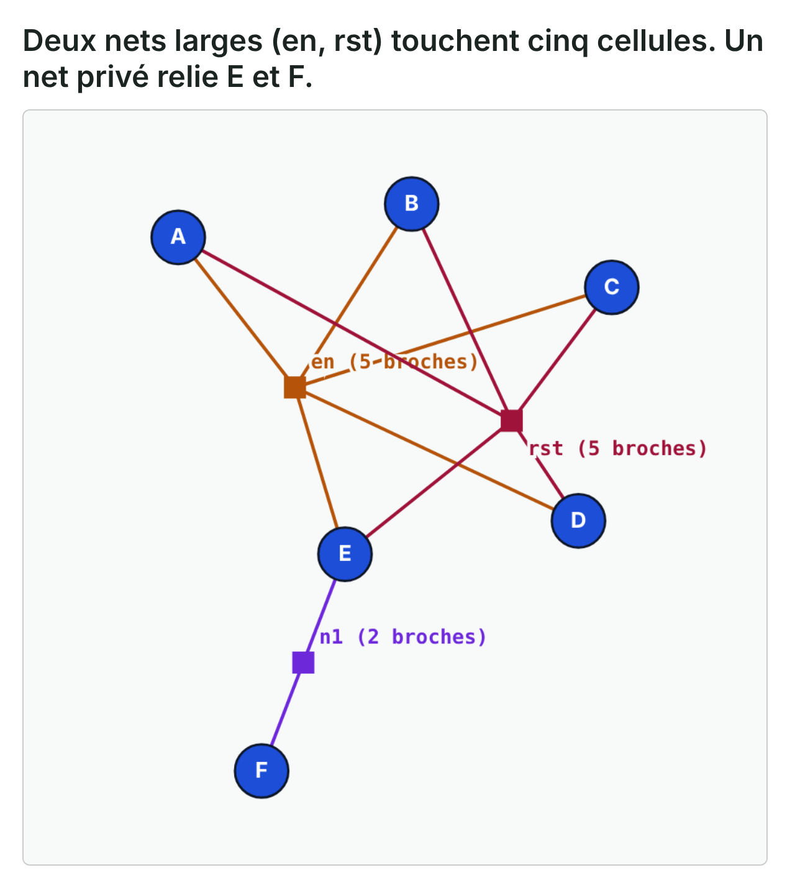

---

## Des nets à nombreuses broches — try these

```
petite netlist : en {A,B,C,D,E}, rst {A,B,C,D,E}, n1 {E,F}

           nombre brut de nets    nombre de broches w/(|e|-1)
A-B        1 + 1 = 2              1/4 + 1/4 = 0.5
E-F        1                      1/1 = 1.0
1re fusion A-B                    E-F
```

---

## Le parcours lab dans le navigateur
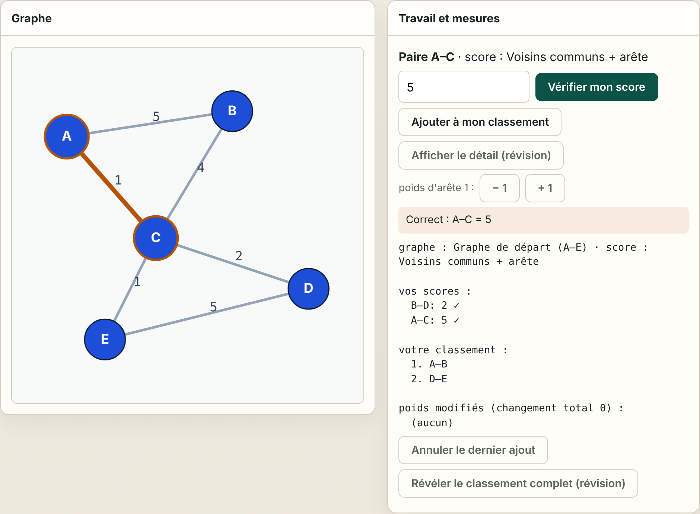

---

## Le parcours implémentation
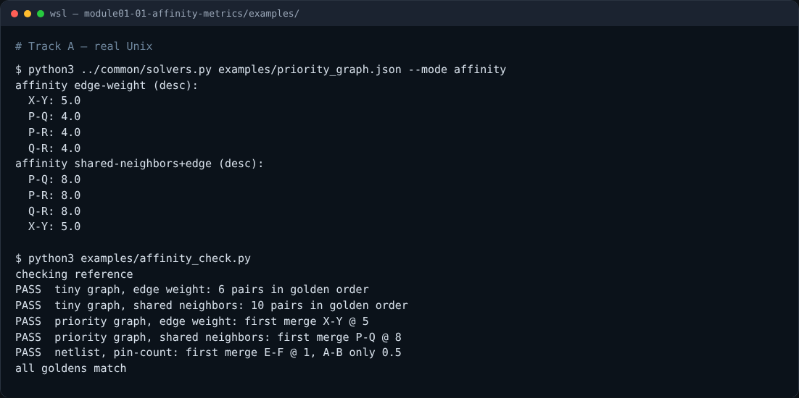

---

## Le parcours implémentation — try these

```
# indiquer à Python où sont les fonctions partagées
export PYTHONPATH=../common

# les deux classements : graphe de départ, puis graphe de priorité
python3 ../common/solvers.py examples/tiny_graph.json --mode affinity
python3 ../common/solvers.py examples/priority_graph.json --mode affinity

# vérifier tous les résultats de référence sur vos propres fonctions
python3 examples/affinity_check.py --impl my_affinity.py
```

---

## Les pièges à éviter
- Attention à quatre erreurs fréquentes
- Compter deux fois une arête, une fois depuis chaque extrémité
- Ajouter le lien le plus fort au lieu du plus faible : tout semble alors proche de tout
- Oublier le départage : A–B et D–E changent de place d'une exécution à l'autre
- Et compter les grands nets partagés à plein poids, ce qui colle des cellules sans rapport

---

## Récapitulatif : trois recettes
- Recette un, le poids d'arête : on ne regarde que le fil direct
- Recette deux, les voisins communs : on ajoute l'aide des amis communs
- Recette trois, le nombre de broches : un grand net partagé compte moins qu'un net privé
- Les égalités se départagent par ordre alphabétique, donc les résultats ne changent jamais
- Des recettes différentes peuvent choisir une première fusion différente
- Choisir la recette est une décision de conception, pas un détail

---

## À vous de jouer
- Essayez les défis du lab, ou écrivez les trois recettes et passez le vérificateur
- Puis expliquez deux choses avec vos propres mots
- D'abord, pourquoi A–C monte-t-elle avec la deuxième recette ?
- Ensuite, pourquoi le graphe de priorité change-t-il sa première fusion ?
- Faites le petit quiz, puis passez à la fusion gloutonne par paires
- Là, ces scores deviennent la règle de fusion

